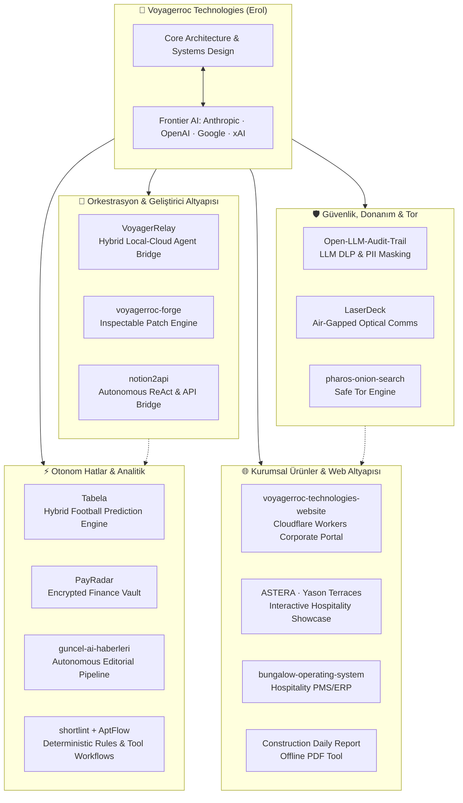

<div align="center">


<br/><br/>

[](https://github.com/Voyagerroc)
[](LICENSE)
[](https://www.linkedin.com/company/voyagerroc-technologies/)
[](https://www.linkedin.com/in/erol-t-66791821a/)
[](https://voyagerroctechnologies.com)
[](mailto:erol@voyagerroctechnologies.com)

<br/><br/>

<!-- AI Transparency & Frontier Engineering -->
<table align="center" style="border-collapse: collapse; border: 1px solid rgba(255,255,255,0.1);">
  <tr>
    <td align="center" style="padding: 16px; background: rgba(15, 23, 42, 0.6);">
      <b>🤖 Yapay Zekâ Eşli Sistem Mühendisliği &amp; Frontier Model Altyapısı</b><br/>
      <sub>Tüm mimari, dağıtık sistemler ve otonom üretim hatları, insan mühendisliği ve frontier AI modellerinin eşli programlama (AI pair-programming) sinerjisiyle geliştirilmektedir:</sub>
      <br/><br/>
      <a href="https://anthropic.com" target="_blank"></a>
      <a href="https://openai.com" target="_blank"></a>
      <a href="https://deepmind.google/technologies/gemini/" target="_blank"></a>
      <a href="https://x.ai" target="_blank"></a>
    </td>
  </tr>
</table>

</div>

---

### 👨‍💻 Hakkımda | About Me

**Voyagerroc Technologies**, sistem mühendisliği, veri güvenliği, donanım düzeyinde iletişim ve ürün odaklı büyüme vizyonunu otonom yapay zekâ hatlarıyla buluşturan yeni nesil bir üretim girişimidir. Tasarlanan ve çalışan tüm projeler soyut konseptler değil; bizzat gerçek donanım, canlı mikroservisler, deterministik kurallar ve üretim ortamında çalışan kod tabanları üzerine kuruludur.

> [!NOTE]
> **Mühendislik Prensibi (AI-Augmented Systems):**  
> Fikir, temel sistem mimarisi, alan mantığı, donanım tasarımı ve uçtan uca doğrulama Erol Taşcı tarafından yürütülür; kod sentezi, test senaryoları, dokümantasyon ve performans optimizasyonunda **Anthropic, OpenAI, Google ve xAI** frontier modelleri şeffaf bir biçimde aktif çalışma ortağı olarak kullanılır.

---

## 🌟 Öne Çıkan Amiral Gemisi: VoyagerRelay | Featured Flagship

<div align="center">
  <h3>🚀 <a href="https://github.com/Voyagerroc/notion-ai-skill">VoyagerRelay</a> (voyager-relay)</h3>
  <p><b>Yerel Ajanlara Güçlü Eller, Sıfır Marjinal Maliyetli Bulut Aklı Verin.</b></p>
</div>

```text
╭─────────────────────────────────────────────────────────────────────────────╮
│  $ voyager-relay -m opus "Design concurrent job queue with backoff"         │
│                                                                             │
│  [Notion AI (Claude Opus 4.6 / Sonnet 5)] >                                 │
│  ✓ Analyzing requirements & bounded concurrency...                          │
│  ✓ Synthesizing type-safe Python implementation...                          │
│                                                                             │
│  ✓ 24 unit tests passed | $0 Marginal API Tokens Billed                     │
╰─────────────────────────────────────────────────────────────────────────────╯
```

* **Nedir?** Google Antigravity, Claude Code, Codex ve Kimi gibi yerel kodlama ajanlarını Notion AI bulut motoruna bağlayan açık kaynaklı hibrit orkestrasyon sistemi.
* **Problem & Çözüm:** Yerel ajanlar yerel dosya ve terminal komutlarını yönetirken yüksek token maliyetine takılır; bulut modelleri ise yerel diskinizi göremez. **VoyagerRelay** yerel ajanı "eller ve hafıza" (dosya okuma, AST yamalama, test koşumu), Notion AI'ı ise "akıl yürütme beyni" (sıfır ek token maliyetli derin reasoning) olarak hibrit çalıştırır.
* **Teknolojiler:** Python 3.10+ · TypeScript · Notion API v3 · Multi-Agent Protocol · Safe AST Patching

---

## 🚀 Projeler & Güncel Kod Yetkinlikleri | Projects & Capabilities

Aşağıdaki liste geçmiş fikirleri değil; **kod depolarındaki güncel işlevleri, mimari bileşenleri ve çalışan modülleri** yansıtır:

### 👑 1. Amiral Gemisi & Açık Kaynak Geliştirici Araçları
| Proje | Güncel İşlev & Kod Özellikleri | Durum | Teknoloji Yığını |
|---|---|:---:|---|
| 🚀 **[VoyagerRelay](https://github.com/Voyagerroc/notion-ai-skill)** | **Hibrit Yapay Zekâ Orkestratörü:** Antigravity ve Claude Code için Notion AI (Opus/Sonnet/GPT) üzerinden sıfır marjinal token maliyetli akıl yürütme köprüsü. | `Public` | Python 3.10+ · CLI · AST Patching · Auto-Fallback |
| 🔨 **[voyagerroc-forge](https://github.com/Voyagerroc/voyagerroc-forge)** | **Denetlenebilir Yama Motoru:** Niyeti doğrulanabilir kod yamalarına çeviren, kapsam sınırlamalı ve gerçek test kanıtlı deneysel geliştirme çatısı. | `Public` | TypeScript · GitHub API · Scoped Edits |
| 🔌 **[notion2api](https://github.com/Voyagerroc/notion2api)** | **Otonom Notion AI API Köprüsü:** ReAct ajan döngüsü, güvenli AST kod yamalayıcı, SQLite görev kuyruğu ve OpenAI uyumlu API köprüsü sağlayan CLI. | `Public` | Node.js · TypeScript · SQLite · ReAct Loop |
| 📟 **[LaserDeck](https://github.com/Voyagerroc/LaserDeck)** | **Hava Boşluklu Optik Lazer Terminali:** Radyo frekansı (RF/Wi-Fi/Bluetooth) olmadan, optik lazer ve fotodiyot üzerinden noktadan noktaya doğrudan ışıkla haberleşen fiziksel donanım PTT ses/veri terminali. | `Public` | ESP32-S3 · C++ · FreeRTOS · AES-256-GCM |
| 🛡️ **[Open-LLM-Audit-Trail](https://github.com/Voyagerroc/Open-LLM-Audit-Trail)** | **LLM DLP & Güvenlik Proxy'si:** LLM API istek/yanıt trafiğinde PII (TCKN, telefon, kart no) ve sırları gerçek zamanlı tespit edip maskeleyen yerel konuşlandırılabilir denetim proxy'si. | `Private` | Python 3.12 · FastAPI · Uvicorn · Docker · DLP |

### ⚡ 2. Yapay Zekâ, Tahmin Motorları & Otonom Hatlar
| Proje | Güncel İşlev & Kod Özellikleri | Durum | Teknoloji Yığını |
|---|---|:---:|---|
| ⚽ **[Tabela](https://github.com/Voyagerroc/Tabela)** | **Canlı Futbol Analitiği & Hibrit Tahmin Motoru:** ESPN API'den canlı maç alımı; Gemini ve NVIDIA LLM modelleriyle hibrit analiz; Poisson/Elo olasılık simülasyonu; Service Worker v4 çevrimdışı PWA/TWA. | `Private` | Node.js · Netlify Functions · PWA · Android TWA |
| 📡 **[PayRadar](https://github.com/Voyagerroc/payradar)** | **Gizlilik Odaklı Finans Kasası:** Düzenli ödemeleri takip eden, 160+ para birimiyle kur çevirici içeren, verileri tarayıcıda AES-256-GCM ile şifreleyen, 5 dilli çevrimdışı PWA/TWA. | `Private` | React 19 · TypeScript · Vite · WebCrypto · Supabase |
| 📰 **[guncel-ai-haberleri](https://github.com/Voyagerroc/guncel-ai-haberleri)** | **Otonom Editoryal Haber Hattı:** 16 doğrulanmış küresel kaynaktan haber toplayan, Jaccard benzerliğiyle birleştiren, 9 editoryal kalıpta işleyip Blogger ve WhatsApp'a yayınlayan otonom sistem. | `Private` | n8n · Node.js · Blogger API · RSS Automation |
| ⚙️ **[AptFlow](https://github.com/Voyagerroc/AptFlow)** | **Bağımsız Uzman Araç İş Akışı:** Harici hesaplara bağımlı olmayan, çevrimdışı demo destekli ve açık sağlayıcı uzantılı Python iş akışı çatısı. | `Public` | Python 3.11 · Modular Workflows · CLI |
| 🎬 **[shortlint](https://github.com/Voyagerroc/shortlint)** | **Kısa Video Kalite Kapısı:** Shorts/Reels/TikTok için yayın öncesi kanca süresi, altyazı konumu ve teknik uyumluluk denetleyen deterministik kural motoru. | `Private` | Python 3.9+ · Setuptools · Deterministik AST |
| 🔍 **[Pharos Onion Search](https://github.com/Voyagerroc/pharos-onion-search)** | **Güvenlik Filtreli Tor Arama Motoru:** Tor ağını tarayan, zararlı içerikleri güvenlik filtresiyle ayıklayan, temiz sayfaları tam metin indeksleyen bağımsız arama motoru. | `Private` | Python 3.12 · Scrapy · Elasticsearch · FastAPI · Tor |
| 🤖 **[telegram-botu](https://github.com/Voyagerroc/telegram-botu)** | **Güvenlikli Uzaktan Sunucu & PC Yönetimi:** Yalnızca sahibine yetki veren; Docker konteyner kontrolü, `/shell` yürütme ve n8n/blog ekosistemi sağlık bekçisi (Watchdog). | `Private` | Docker · Python · Windows Host Agent · Watchdog |

### 🏢 3. Açık Standartlar & Protokol Organizasyonları
| Organizasyon / Depo | Güncel İşlev & Kod Özellikleri | Durum | Teknoloji Yığını |
|---|---|:---:|---|
| 🌐 **[Atlas Global OS](https://github.com/Voyagerroc/atlas-core)** | **Platformlar Arası Güven & İtibar Katmanı:** Düğümleri kaydeden, güvenilirlik derecesini puanlayan ve erişimi filtreleyen taşınabilir kimlik spesifikasyonu ve kontrol düzlemi. | `Private` | TypeScript · `atlas-core` · `atlas-spec` · `atlas-cli` |
| 🎯 **[Evidence Intelligence Platform](https://github.com/Voyagerroc/eip-core)** | **Kanıta Dayalı Yetenek Değerlendirme:** Aday özgeçmişlerinden deterministik olarak doğrulanabilir kanıtları çıkaran, açık rıza kapısı ve Zero-Trust API sınırlarıyla çalışan AI değerlendirme motoru. | `Private` | FastAPI · Next.js · PostgreSQL · `eip-android` (Kotlin) |

### 🌐 4. Web Mimarisi, Turizm & Sektörel Uygulamalar
| Proje | Güncel İşlev & Kod Özellikleri | Durum | Teknoloji Yığını |
|---|---|:---:|---|
| 🌍 **[Voyagerroc Technologies Website](https://github.com/Voyagerroc/voyagerroc-technologies-website)** | **Kurumsal Teknoloji Portalı:** İki dilli ürün portföyü, interaktif 3D anlatım ve bağımsız Cloudflare Workers üzerinde barındırılan resmi kurumsal vitrin. | `Public` | Cloudflare Workers · HTML5 · Modern CSS · 3D Canvas |
| ⭐ **[ASTERA (Yason Terraces)](https://github.com/Voyagerroc/yason-terraces)** | **İnteraktif Bungalov Vitrini:** Ordu Perşembe / Çaytepe'deki 15 adet A-frame bungalov tesisi için geliştirilmiş çok dilli (TR/EN) interaktif tanıtım ve rezervasyon vitrini. | `Public` | Vite · TypeScript · Modern Responsive CSS |
| 🏡 **[bungalow-operating-system](https://github.com/Voyagerroc/bungalow-operating-system)** | **Bungalov Operasyon Sistemi:** 15 üniteli premium tesisler için PMS, ERP, kat hizmetleri, havuz/jakuzi bakım takibi ve acil durum uyarı motoru içeren operasyon platformu. | `Private` | TypeScript · pnpm Monorepo · Modular Ops |
| 📋 **[Construction Daily Report](https://github.com/Voyagerroc/Voyagerroc-Construction-Daily-Report)** | **Kurulumsuz Şantiye Raporlama Aracı:** Günlük personel, ilerleme, hava durumu ve makine verilerini dakikalar içinde profesyonel A4 PDF raporuna çeviren sıfır kurulumlu saha aracı. | `Private` | Vanilla JS · jsPDF · Web Storage |
| 🏗️ **[sarihan-interactive-showcase](https://github.com/Voyagerroc/sarihan-interactive-showcase)** | **Scroll-Driven Animasyon Vitrini:** İnşaat sektörü için modern CSS scroll-driven etkileşimleri ve pürüzsüz kaydırmayı birleştiren mimari referans demosu. | `Private` | React · Vite · TypeScript · CSS Scroll-Driven |

---

## 🗺️ Sistem Mimarisi | System Architecture



---

## 💻 Teknolojiler & Yetkinlikler | Tech Stack

<p align="center">
  <b>Diller & Çekirdek Mühendislik</b><br/>
  
  
  
  
  
  
</p>

<p align="center">
  <b>Yapay Zekâ, Ajanlar & Backend</b><br/>
  
  
  
  
  
  
  
  
  
</p>

<p align="center">
  <b>Gömülü Sistemler, Donanım & Şifreleme</b><br/>
  
  
  
  
</p>

<p align="center">
  <b>Frontend, Mobil & Dağıtım Altyapısı</b><br/>
  
  
  
  
  
  
</p>

---

<div align="center">

*Bu profil, güvenli mimariler, sıfır maliyetli otonom hatlar ve gerçek dünya ürünleri inşa eden mühendislik disiplinini temsil eder.*  
**Erol · Voyagerroc Technologies**

</div>

## Lisans | License

[MIT](LICENSE) © 2026 Erol Tasci
