# Erol Taşcı · Voyagerroc Technologies

I build local developer tools, inspectable AI workflows and offline Android apps.
Yerel geliştirici araçları, incelenebilir yapay zekâ iş akışları ve çevrimdışı Android uygulamaları geliştiriyorum.

[Website / Ürünler](https://voyagerroctechnologies.com) · [About / Hakkımda](https://voyagerroctechnologies.com/erol-tasci/) · [Email](mailto:erol@voyagerroctechnologies.com)

## Selected projects / Seçilmiş projeler

| Project | What works / Çalışan kapsam | Try it / İncele |
| --- | --- | --- |
| **[VoyagerRelay](https://github.com/Voyagerroc/notion-ai-skill)** | Local-agent workflow and prompt packaging for the separate Notion AI bridge. / Yerel ajan iş akışı ve istem paketleme. | [Setup and boundaries](https://github.com/Voyagerroc/notion-ai-skill#readme) |
| **[Voyagerroc Forge](https://github.com/Voyagerroc/voyagerroc-forge)** | Experimental, single-user patch workflow with pinned source, scoped edits and named static checks. / Deneysel, yerel yama iş akışı. | [Offline local demo](https://github.com/Voyagerroc/voyagerroc-forge#try-it-in-two-minutes) |
| **[AptFlow](https://github.com/Voyagerroc/AptFlow)** | Python starter with a synthetic, account-free storyboard workflow. Live provider adapters remain stubs. / Hesapsız sentetik demo; canlı adaptörler henüz uygulanmadı. | [Offline quickstart](https://github.com/Voyagerroc/AptFlow#quickstart) |
| **[LaserDeck PTT](https://github.com/Voyagerroc/LaserDeck)** | Android/Kotlin phone-to-phone Bluetooth communication: push-to-talk, calls, messages and photos. / Telefonlar arası Bluetooth iletişim. | [Product and access status](https://voyagerroctechnologies.com/urunler/laserdeck/) |
| **[notion2api](https://github.com/Voyagerroc/notion2api)** | Python/FastAPI bridge and CLI with a SQLite task queue. Uses an unofficial Notion web integration. / Ayrı çalıştırılabilir köprü ve CLI. | [Installation](https://github.com/Voyagerroc/notion2api#readme) |
| **[Corporate website](https://github.com/Voyagerroc/voyagerroc-technologies-website)** | Bilingual product catalogue on Cloudflare Workers. / İki dilli ürün kataloğu. | [Live site](https://voyagerroctechnologies.com) |
| **[Yason Terraces](https://github.com/Voyagerroc/yason-terraces)** | Architectural hospitality showcase. / Mimari konaklama vitrini. | [Source and local setup](https://github.com/Voyagerroc/yason-terraces#readme) |

**PayRadar** is a native Android payment and subscription tracker (Kotlin, Compose, Room); its former web app is retired. Source access is private. See the [public product page and access status](https://voyagerroctechnologies.com/urunler/payradar/).

A source repository, a local demo and a publicly available release are different stages. Each project's documentation describes its current scope and limitations. / Kaynak, yerel demo ve genel dağıtım ayrı aşamalardır; güncel erişim ve sınırlar proje sayfalarında açıklanır.

## Open-source contributions / Açık kaynak katkıları

Merged upstream contributions / Dış projelerde birleştirilen katkılar:

- [lithent #122 — document the SSR package](https://github.com/superlucky84/lithent/pull/122)
- [Islet #211 — add area and pressure unit conversions](https://github.com/goprocker/Islet/pull/211)
- [Opgit #12 — trim the search query](https://github.com/elisAITech/Opgit/pull/12)

In review when this profile was updated: [Mintmap #20 — all-gap CLI output](https://github.com/mohamedmoatazsec/mintmap/pull/20) and [dyadMLM #181 — contrast-column documentation](https://github.com/Pascal-Kueng/dyadMLM/pull/181). These are open PRs; opening approval is separate from merge approval.

## Contribute / Katkıda bulun

Small, reproducible improvements are welcome. Read the contribution guide and check the issue discussion before starting. / Küçük, tekrar üretilebilir iyileştirmeler için önce katkı kılavuzunu ve issue tartışmasını okuyun.

| Project | Contribution guide / Kılavuz | Starter issues / Başlangıç işleri |
| --- | --- | --- |
| [Forge](https://github.com/Voyagerroc/voyagerroc-forge) | [Forge CONTRIBUTING](https://github.com/Voyagerroc/voyagerroc-forge/blob/main/CONTRIBUTING.md) | [Forge open good-first issues](https://github.com/Voyagerroc/voyagerroc-forge/issues?q=is%3Aissue+is%3Aopen+label%3A%22good+first+issue%22) |
| [AptFlow](https://github.com/Voyagerroc/AptFlow) | [AptFlow CONTRIBUTING](https://github.com/Voyagerroc/AptFlow/blob/main/CONTRIBUTING.md) | [AptFlow open good-first issues](https://github.com/Voyagerroc/AptFlow/issues?q=is%3Aissue+is%3Aopen+label%3A%22good+first+issue%22) |

An issue label does not promise assignment, a response time or a merge. / Etiket; görev ataması, yanıt süresi veya birleştirme sözü değildir.

## How I work / Çalışma biçimim

I use AI assistants for implementation, review and documentation, and report the checks actually run. Human review and project-specific validation remain necessary. / Uygulama, inceleme ve dokümantasyonda yapay zekâ yardımı kullanıyorum; gerçekten çalıştırılan kontrolleri bildiriyorum.

VoyagerRelay and notion2api depend on eligible Notion access, quotas and service behavior. They do not guarantee free inference, fixed model availability or production suitability. See [cost and availability](https://github.com/Voyagerroc/notion-ai-skill#cost-and-availability).

## Profile maintenance / Profil bakımı

[Run the offline link and asset checks](CONTRIBUTING.md). External URL checks are optional and distinguish missing pages from rate limits or temporary failures.

[MIT](LICENSE) © 2026 Erol Tasci
