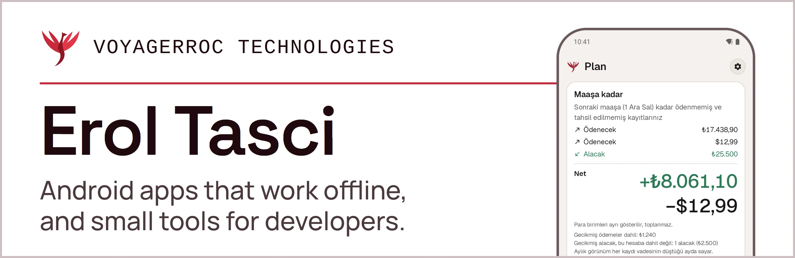
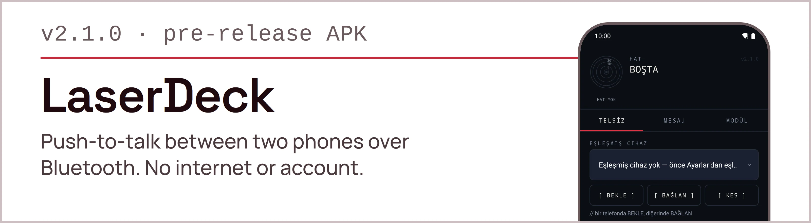
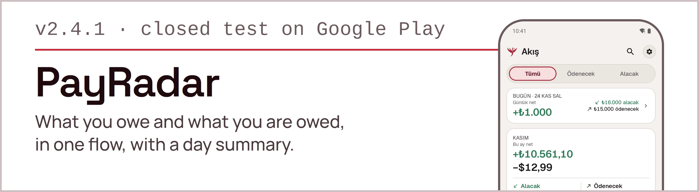
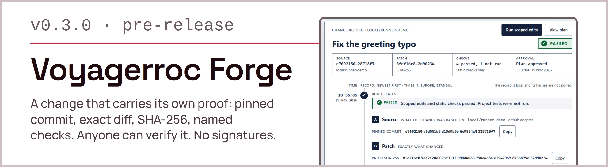
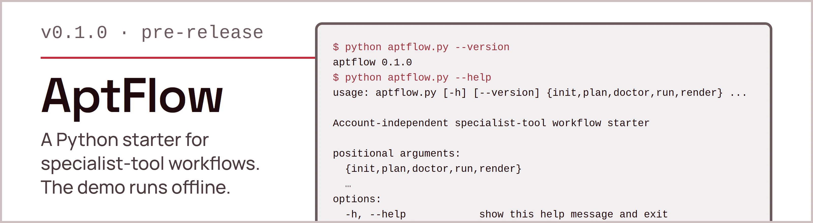

<a href="README.tr.md">Türkçe</a>

<picture>
  <source media="(prefers-color-scheme: dark)" srcset="assets/banner-v3-en-dark.webp">
  
</picture>

I'm Erol Tasci. I build Android apps that work offline and small tools for developers, as Voyagerroc Technologies. I write the scope down before the work starts, and each project below says what is finished and what is not.

[Website](https://voyagerroctechnologies.com/en/) · [Contact](https://voyagerroctechnologies.com/en/legal/contact/) · [Türkçe](README.tr.md)

## Selected work

<a href="https://github.com/Voyagerroc/LaserDeck">
<picture>
  <source media="(prefers-color-scheme: dark)" srcset="assets/work-laserdeck-en-dark.webp">
  
</picture>
</a>

**LaserDeck** · v2.1.0 pre-release APK. Push-to-talk between two phones over Bluetooth. No internet or account. The screen is a real capture from the 2.1.0 debug build on an Android emulator, idle because no second phone was connected; the app interface is in Turkish. It has not been re-tested on two physical phones for this release. [Repository](https://github.com/Voyagerroc/LaserDeck) · [Release&nbsp;v2.1.0](https://github.com/Voyagerroc/LaserDeck/releases/tag/v2.1.0) · [Product page](https://voyagerroctechnologies.com/en/urunler/laserdeck/)

<a href="https://voyagerroctechnologies.com/en/products/payradar/">
<picture>
  <source media="(prefers-color-scheme: dark)" srcset="assets/work-payradar-v2-4-1-en-dark.webp">
  
</picture>
</a>

**PayRadar** · version 2.4.1 (22), Google Play closed test (Alpha) since 24 November 2026. Follow what you owe and what you are owed in one flow, with a day summary, calendar and plan, and local reminders. New in 2.4.1: the Shared Ledger downloads as an Excel file, deleted ledger entries can be restored for 30 days, and screenshots are blocked while the ledger is open (this can be turned off in Settings). The source code is private. The screen is a real emulator capture of 2.4.1 with fictional sample data; the app interface is in Turkish. [Product page](https://voyagerroctechnologies.com/en/products/payradar/) · [60-second screen tour](https://voyagerroctechnologies.com/assets/demos/payradar-native-241-20261124-en.mp4)

<a href="https://github.com/Voyagerroc/voyagerroc-forge">
<picture>
  <source media="(prefers-color-scheme: dark)" srcset="assets/work-forge-v0-3-0-en-dark.webp">
  
</picture>
</a>

**Voyagerroc Forge** · v0.3.0 pre-release. A change that carries its own proof: Forge records a change with its pinned commit, the exact diff, SHA-256 digests and named checks, and anyone can re-check the source, the exact change and the static checks. It runs locally for one user, and the hashes carry no signature. The screen is a capture of Forge's own interface on a local fixture. [Repository](https://github.com/Voyagerroc/voyagerroc-forge) · [Release&nbsp;v0.3.0](https://github.com/Voyagerroc/voyagerroc-forge/releases/tag/v0.3.0)

<a href="https://github.com/Voyagerroc/AptFlow">
<picture>
  <source media="(prefers-color-scheme: dark)" srcset="assets/work-aptflow-en-dark.webp">
  
</picture>
</a>

**AptFlow** · v0.1.0 pre-release. A Python starter for specialist-tool workflows. The demo runs offline on synthetic data, and the live provider adapters are not implemented. The terminal shows the real output of `python aptflow.py --version` and `python aptflow.py --help`, shortened. [Repository](https://github.com/Voyagerroc/AptFlow) · [Release&nbsp;v0.1.0](https://github.com/Voyagerroc/AptFlow/releases/tag/v0.1.0)

## Also here

- [yason-terraces](https://github.com/Voyagerroc/yason-terraces): a static showcase site for an architectural hospitality project. [Live preview](https://voyagerroc.github.io/yason-terraces/)
- [notion-ai-skill](https://github.com/Voyagerroc/notion-ai-skill): agent instructions and installers for an unofficial local Notion AI bridge.
- [notion2api](https://github.com/Voyagerroc/notion2api): an unofficial Python command-line tool and local API bridge for Notion AI. It needs your own eligible account.

## Upstream contributions

Pull requests to other projects that were merged:

- [lithent #122](https://github.com/superlucky84/lithent/pull/122): add a README for the SSR package
- [Islet #211](https://github.com/goprocker/Islet/pull/211): add area and pressure kinds to the Units tool
- [Opgit #12](https://github.com/elisAITech/Opgit/pull/12): trim the search query before filtering
- [dyadMLM #181](https://github.com/Pascal-Kueng/dyadMLM/pull/181): say where the `.member_contrast_*` columns may be used

---

Voyagerroc Technologies · [voyagerroctechnologies.com](https://voyagerroctechnologies.com/en/)
