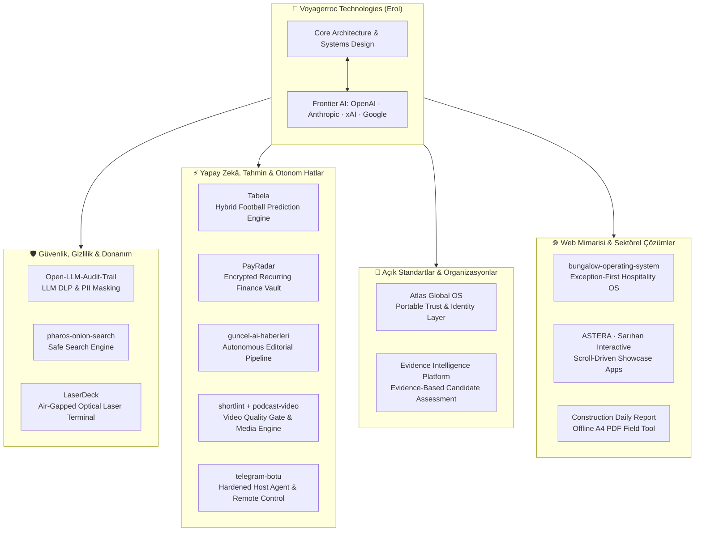

  

[erol@voyagerroctechnologies.com](mailto:erol@voyagerroctechnologies.com)

  

<!-- AI Transparency & Foundation Models -->
<table align="center">
  <tr>
    <td align="center">
      <b>🤖 Yapay Zekâ Eşli Mühendislik &amp; Frontier Model Altyapısı</b> 
      Bu profildeki ve bağlı sistemlerdeki mimari, kodlama ve otomasyon süreçleri aşağıdaki yapay zekâ öncüsü modeller ile eşli programlama (AI pair-programming) prensibiyle geliştirilmektedir:
        
      
      
      
      
    </td>
  </tr>
</table>

---

### 👨‍💻 Hakkımda | About Me

**Voyagerroc Technologies**, sistem mühendisliği, veri güvenliği ve ürün odaklı büyüme vizyonunu yapay zekâ odaklı otonom sistemlerle birleştiren yeni nesil bir üretim girişimidir. Tasarlanan ve çalışan tüm projeler soyut fikirler değil; bizzat gerçek donanım, canlı API'ler, deterministik kurallar ve çalışan kod tabanları üzerine kuruludur.

> [!NOTE]
> **Mühendislik İlkesi (AI-Augmented Systems):**  
> Fikir, temel mimari kurgusu, alan mantığı, donanım tasarımı ve uçtan uca doğrulama tarafımdan yürütülür; kod üretimi, test senaryoları, dokümantasyon ve optimizasyon aşamalarında **OpenAI, Anthropic, xAI (x.ai) ve Google** frontier modelleri şeffaf bir biçimde aktif iş ortağı (AI pair-programming) olarak kullanılır.

---

## 🚀 Projeler & Güncel Kod Yetkinlikleri | Projects & Capabilities

Aşağıdaki tanımlar geçmiş fikirleri değil; **kod depolarındaki güncel işlevleri, mimari bileşenleri ve çalışan modülleri** yansıtır:

### 🛡️ Güvenlik, Gizlilik & Donanım Mühendisliği
| Proje | Güncel İşlev & Kod Özellikleri | Teknoloji Yığını |
|---|---|---|
| 📟 **[LaserDeck](https://github.com/Voyagerroc/LaserDeck)** | **Hava Boşluklu Optik Lazer Terminali:** Radyo frekansı (RF/Wi-Fi/Bluetooth) yayılımı olmadan, optik lazer ve fotodiyotlar üzerinden noktadan noktaya doğrudan ışıkla haberleşen fiziksel el terminali ve donanım PTT ses/veri cihazı. | ESP32-S3 · C++ · FreeRTOS · AES-256-GCM |
| 🛡️ **[Open-LLM-Audit-Trail](https://github.com/Voyagerroc/Open-LLM-Audit-Trail)** | **LLM DLP & Güvenlik Proxy'si:** LLM API istek/yanıt trafiğinde PII (TCKN, telefon, kart no) ve sırları (API key, token) gerçek zamanlı tespit edip maskeleyen, sıfır veri sızıntısı sağlayan yerel konuşlandırılabilir denetim proxy'si. | Python 3.12 · FastAPI · Uvicorn · Docker · DLP |
| 🔍 **[Pharos Onion Search](https://github.com/Voyagerroc/pharos-onion-search)** | **Güvenlik Filtreli Tor Arama Motoru:** Tor (.onion) ağını tarayan, zararlı/yasa dışı içerikleri otomatik güvenlik filtresiyle ayıklayan, temiz sayfaları tam metin indeksleyen bağımsız arama motoru. | Python 3.12 · Scrapy · Elasticsearch · FastAPI · Tor |

### ⚡ Yapay Zekâ, Tahmin Motorları & Otonom Hatlar
| Proje | Güncel İşlev & Kod Özellikleri | Teknoloji Yığını |
|---|---|---|
| ⚽ **[Tabela](https://github.com/Voyagerroc/Tabela)** | **Canlı Futbol Analitiği & Hibrit Tahmin Motoru:** ESPN API'den canlı maç/fikstür alımı; Google Gemini ve NVIDIA LLM modelleriyle hibrit analiz; Poisson/Elo olasılık simülasyonu; Service Worker v4 çevrimdışı önbellekleme ve tam ekran Android TWA istemcisi. | Node.js · Netlify Functions · PWA · Android TWA |
| 📡 **[PayRadar](https://github.com/Voyagerroc/payradar)** | **Gizlilik Odaklı Finans Kasası:** Düzenli ödemeleri (kira, fatura, abonelik) takip eden, 160+ para birimiyle canlı kur çevirici içeren, verileri tarayıcıda AES-256-GCM ile şifreleyen, 5 dilli çevrimdışı PWA/TWA uygulaması. | React 19 · TypeScript · Vite · WebCrypto · Supabase |
| 📰 **[guncel-ai-haberleri](https://github.com/Voyagerroc/guncel-ai-haberleri)** | **Otonom Editoryal Haber Hattı:** 16 doğrulanmış küresel AI kaynağından haberleri çeken, Jaccard benzerliğiyle tek hikayede birleştiren, 9 editoryal kalıpta işleyip Blogger ve WhatsApp bültenine günde 8 yazı yayınlayan otonom sistem. | n8n · Node.js (Editor Masası) · Blogger API · RSS |
| 🎬 **[shortlint](https://github.com/Voyagerroc/shortlint)** | **Kısa Video Kalite Kapısı (Lighthouse for Shorts):** Dikey kısa videolar (Shorts/Reels/TikTok) için yayın öncesi kanca süresi, altyazı konumu, süre tavanı ve teknik uyumluluk denetleyen deterministik kural motoru. | Python 3.9+ · Setuptools · Deterministik AST |
| 🎙️ **podcast-video** | **Podcast'ten Videoya Üretim Hattı:** Türkçe ses kayıtlarını zaman kodlu transkripte dönüştüren, SDXL ile her sahne için görsel üreten ve Premiere Pro'ya montaja hazır XML zaman çizelgesi çıkaran otomatik görsel video hattı. | Python · OpenAI Whisper · SDXL · Premiere XML |
| 🤖 **[telegram-botu](https://github.com/Voyagerroc/telegram-botu)** | **Güvenlikli Uzaktan Sunucu & PC Yönetimi:** Yalnızca sahibine komut yetkisi veren; Docker konteyner kontrolü, `/shell` yürütme, Windows yerel servis köprüsü ve n8n/blog ekosistemi sağlık bekçisi (Watchdog) içeren uzaktan yönetim sistemi. | Docker · Python · Windows Host Agent · Watchdog |
| 🧠 **[prompt-operating-system](https://github.com/Voyagerroc/prompt-operating-system)** | **Prompt Mimarisi & Metaprompting Standardı:** Otonom yapay zekâ ajanları ve generatif video modelleri için PROMPT GEM X evrensel sistem promptu ve 8 elemanlı yapılandırılmış prompt standardı. | Prompt Architecture · Meta-Prompting |
| 🐳 **[infrastructure](https://github.com/Voyagerroc/infrastructure)** | **Konteyner Orkestrasyon Altyapısı:** n8n iş akışı motoru, Automation-OS, PostgreSQL ve Redis servislerini tek komutla ayağa kaldıran üretim düzeyinde Docker Compose altyapı deposu. | Docker Compose · PostgreSQL · Redis · n8n |

### 🏢 Açık Standartlar & Protokol Organizasyonları
| Organizasyon / Depo | Güncel İşlev & Kod Özellikleri | Teknoloji Yığını |
|---|---|---|
| 🌐 **[Atlas Global OS](https://github.com/Voyagerroc/atlas-core)** | **Platformlar Arası Güven & İtibar Katmanı:** Düğümleri kaydeden, güvenilirlik derecesini puanlayan ve erişimi bu puana göre filtreleyen taşınabilir kimlik spesifikasyonu ve kontrol düzlemi terminal istemcisi. | TypeScript · `atlas-core` · `atlas-spec` · `atlas-cli` |
| 🎯 **[Evidence Intelligence Platform](https://github.com/Voyagerroc/eip-core)** | **Kanıta Dayalı Yetenek Değerlendirme:** Aday özgeçmişlerinden deterministik olarak doğrulanabilir kanıtları çıkaran, açık rıza kapısı ve Zero-Trust API sınırlarıyla çalışan şeffaf AI değerlendirme motoru ve mobil istemcisi. | FastAPI · Next.js · PostgreSQL · `eip-android` (Kotlin) |

### 🌐 Web Mimarisi, İnşaat & Sektörel Uygulamalar
| Proje | Güncel İşlev & Kod Özellikleri | Teknoloji Yığını |
|---|---|---|
| 🏡 **[bungalow-operating-system](https://github.com/Voyagerroc/bungalow-operating-system)** | **Bungalov Operasyon Sistemi:** 15 üniteli premium tesisler için PMS, ERP, kat hizmetleri, havuz/jakuzi bakım takibi, CRM ve acil durum uyarı motoru içeren "Exception-First" mimarili operasyon platformu. | TypeScript · pnpm Monorepo · Modular Ops |
| ⭐ **[ASTERA](https://github.com/Voyagerroc/yason-terraces)** | **İnteraktif Bungalov Vitrini:** Ordu Perşembe / Çaytepe'deki 15 adet A-frame bungalov tesisi için geliştirilmiş, çok dilli (TR/EN) interaktif tanıtım ve rezervasyon vitrini. | Vite · TypeScript · Modern Responsive CSS |
| 🏗️ **[sarihan-interactive-showcase](https://github.com/Voyagerroc/sarihan-interactive-showcase)** | **Scroll-Driven Animasyon Vitrini:** İnşaat sektörü için modern CSS scroll-driven etkileşimleri, pürüzsüz kaydırmayı ve yüksek performanslı animasyon tekniklerini bir araya getiren mimari referans demosu. | React · Vite · TypeScript · CSS Scroll-Driven |
| 📋 **[Construction Daily Report](https://github.com/Voyagerroc/Voyagerroc-Construction-Daily-Report)** | **Kurulumsuz Şantiye Raporlama Aracı:** Şantiyede günlük personel, ilerleme, hava durumu ve makine verilerini dakikalar içinde profesyonel A4 PDF raporuna çeviren sıfır kurulumlu, çevrimdışı saha aracı. | Vanilla JS · jsPDF · Web Storage |
| 📐 **[sarihan-insaat-3](https://github.com/Voyagerroc/sarihan-insaat-3) & [mimari-cad](https://github.com/Voyagerroc/mimari-cad)** | **Mimari Proje Vitrini & CAD/BIM Hattı:** Fatsa karma konut projesi tanıtım sitesi ve DWG mimari çizimlerini webde gösterilebilir 3D modellere dönüştüren CAD işleme hattı. | HTML5 · CSS3 · Vanilla JS · DWG to 3D Pipeline |
| 🎨 **[artisan-web](https://github.com/Voyagerroc/artisan-web)** | **Tasarım Stüdyosu Standartları:** Tipografi, boşluk hiyerarşisi ve bileşen dengesi optimize edilmiş modern web uygulamaları inşa etmek için geliştirilmiş tasarım standartları kütüphanesi. | Responsive Layouts · Semantic HTML · CSS Architecture |

---

## 🗺️ Mimari Haritası | System Architecture

---

## 💻 Teknolojiler & Yetkinlikler | Tech Stack

  <b>Diller & Çekirdek</b> 
  
  
  
  
  

  <b>Yapay Zekâ, Backend & Veri Güvenliği</b> 
  
  
  
  
  
  
  
  
  
  

  <b>Gömülü, Donanım & Şifreleme</b> 
  
  
  
  

  <b>Frontend, Mobil & Dağıtım</b> 
  
  
  
  
  
  

---

*Bu profil, güvenli mimariler ve otonom sistemler inşa eden mühendislik yaklaşımını yansıtır.*  
**Erol · Voyagerroc Technologies**

## License

[MIT](LICENSE) © 2026 Erol Tasci
