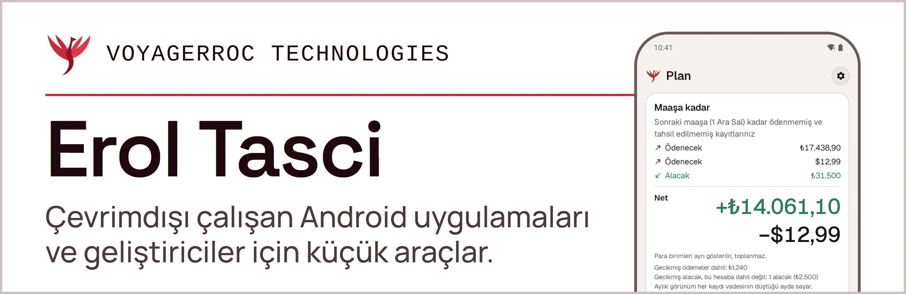
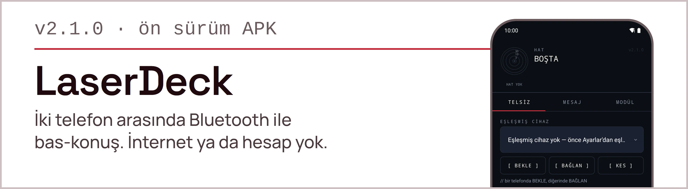
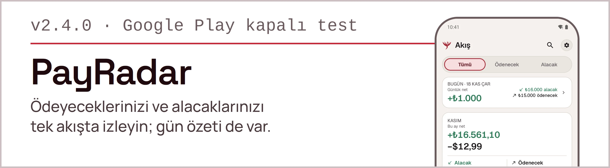
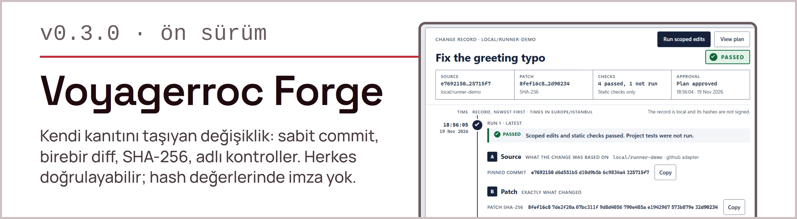
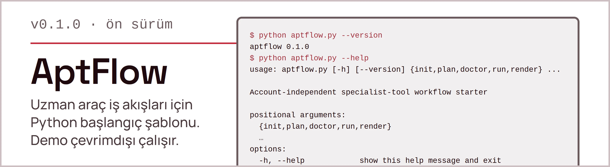

<a href="README.md">English</a>

<picture>
  <source media="(prefers-color-scheme: dark)" srcset="assets/banner-v2-tr-dark.webp">
  
</picture>

Ben Erol Tasci. Voyagerroc Technologies adıyla çevrimdışı çalışan Android uygulamaları ve geliştiriciler için küçük araçlar yapıyorum. İşe başlamadan önce kapsamı yazıyorum; aşağıdaki her proje neyin tamamlandığını, neyin tamamlanmadığını kendisi söyler.

[Web sitesi](https://voyagerroctechnologies.com/) · [İletişim](https://voyagerroctechnologies.com/yasal/iletisim/) · [English](README.md)

## Seçilmiş çalışmalar

<a href="https://github.com/Voyagerroc/LaserDeck">
<picture>
  <source media="(prefers-color-scheme: dark)" srcset="assets/work-laserdeck-tr-dark.webp">
  
</picture>
</a>

**LaserDeck** · v2.1.0 ön sürüm APK. İki telefon arasında Bluetooth ile bas-konuş. İnternet ya da hesap yok. Ekran, 2.1.0 hata ayıklama sürümünün Android emülatöründeki gerçek bir görüntüsüdür; ikinci telefon bağlı olmadığı için boşta durumundadır. Bu sürüm iki gerçek telefonda yeniden denenmemiştir. [Depo](https://github.com/Voyagerroc/LaserDeck) · [v2.1.0&nbsp;sürümü](https://github.com/Voyagerroc/LaserDeck/releases/tag/v2.1.0) · [Ürün sayfası](https://voyagerroctechnologies.com/urunler/laserdeck/)

<a href="https://voyagerroctechnologies.com/urunler/payradar/">
<picture>
  <source media="(prefers-color-scheme: dark)" srcset="assets/work-payradar-v2-4-0-tr-dark.webp">
  
</picture>
</a>

**PayRadar** · Google Play'de kapalı test, 2.4.0 sürümü. Ödeyeceklerinizi ve alacaklarınızı tek akışta izleyin; gün özeti, takvim ve plan da var, hatırlatmalar cihazda çalışır. Kaynak kodu özeldir. Ekran, kurgusal örnek verili gerçek bir emülatör görüntüsüdür. [Ürün sayfası](https://voyagerroctechnologies.com/urunler/payradar/)

<a href="https://github.com/Voyagerroc/voyagerroc-forge">
<picture>
  <source media="(prefers-color-scheme: dark)" srcset="assets/work-forge-v0-3-0-tr-dark.webp">
  
</picture>
</a>

**Voyagerroc Forge** · v0.3.0 ön sürüm. Kendi kanıtını taşıyan değişiklik: Forge bir değişikliği sabitlenmiş commit'i, birebir diff'i, SHA-256 değerleri ve adlandırılmış kontrolleriyle kaydeder; kaydı herkes yeniden doğrulayabilir. Tek kullanıcı için yerelde çalışır, hash değerlerinde imza yoktur. Ekran, Forge'un kendi arayüzünün yerel bir test düzeneğindeki görüntüsüdür. [Depo](https://github.com/Voyagerroc/voyagerroc-forge) · [v0.3.0&nbsp;sürümü](https://github.com/Voyagerroc/voyagerroc-forge/releases/tag/v0.3.0)

<a href="https://github.com/Voyagerroc/AptFlow">
<picture>
  <source media="(prefers-color-scheme: dark)" srcset="assets/work-aptflow-tr-dark.webp">
  
</picture>
</a>

**AptFlow** · v0.1.0 ön sürüm. Uzman araç iş akışları için Python başlangıç şablonu. Demo, sentetik veriyle çevrimdışı çalışır; canlı sağlayıcı bağdaştırıcıları henüz uygulanmamıştır. Terminal, `python aptflow.py --version` ve `python aptflow.py --help` komutlarının gerçek çıktısını kısaltılmış olarak gösterir. [Depo](https://github.com/Voyagerroc/AptFlow) · [v0.1.0&nbsp;sürümü](https://github.com/Voyagerroc/AptFlow/releases/tag/v0.1.0)

## Burada ayrıca

- [yason-terraces](https://github.com/Voyagerroc/yason-terraces): mimari bir konaklama projesi için statik vitrin sitesi. [Canlı önizleme](https://voyagerroc.github.io/yason-terraces/)
- [notion-ai-skill](https://github.com/Voyagerroc/notion-ai-skill): resmî olmayan yerel bir Notion AI köprüsü için ajan yönergeleri ve kurulum betikleri.
- [notion2api](https://github.com/Voyagerroc/notion2api): Notion AI için resmî olmayan Python komut satırı aracı ve yerel API köprüsü. Notion AI'ye erişimi olan kendi hesabınız gerekir.

## Dış projelere katkılar

Diğer projelere gönderilen ve birleştirilen çekme istekleri:

- [lithent #122](https://github.com/superlucky84/lithent/pull/122): SSR paketi için README eklendi
- [Islet #211](https://github.com/goprocker/Islet/pull/211): Birimler aracına alan ve basınç türleri eklendi
- [Opgit #12](https://github.com/elisAITech/Opgit/pull/12): Filtrelemeden önce arama sorgusu kırpıldı
- [dyadMLM #181](https://github.com/Pascal-Kueng/dyadMLM/pull/181): `.member_contrast_*` sütunlarının nerede kullanılabileceği belgelendi

---

Voyagerroc Technologies · [voyagerroctechnologies.com](https://voyagerroctechnologies.com/)
